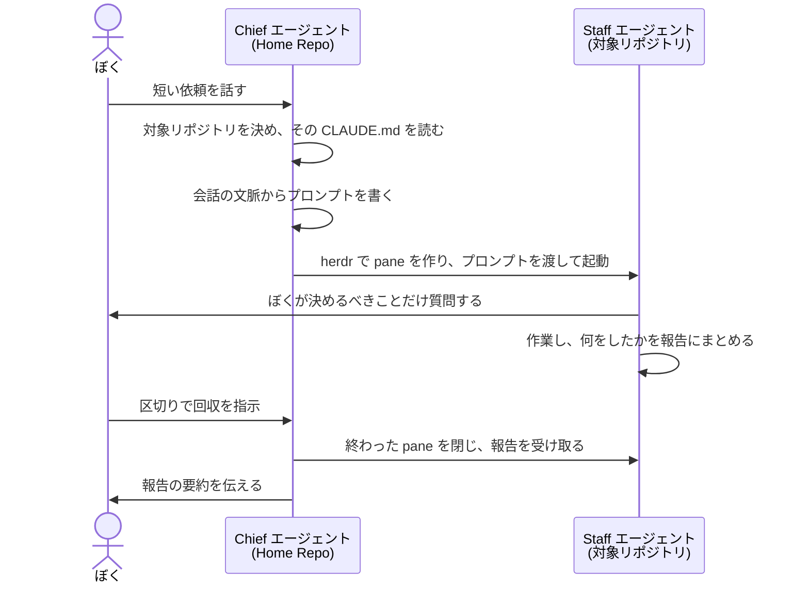

ブログを書きたくなったらblogリポジトリに移動して、エージェントを立ち上げる。メモを整理したくなったら、今度はナレッジベースのリポジトリに移動して、また別のエージェントを立ち上げる。そして、どちらのエージェントにもさっき別のエージェントに話したばかりの背景を一から説明し直す。最近まで、ぼくはこれを毎日やっていました。

打ち直す手間も面倒ですが、本当に重いのは別のところでした。「このエージェントには、あの前提をもう話したっけ」を覚えておくことです。並行して動かすエージェントが3つ、4つと増えると、誰に何を渡したかを全部頭の中で覚えておくことになります。覚えきれなくなると、渡し忘れた前提をエージェントがもっともらしく補って、的外れな作業が返ってきます。

これ、人に仕事を振るときとまったく同じ悩みなんですよね。相手がエージェントになれば消えると思っていたのに、ちゃんと残っていました。

そこで、いまはプロンプトを書く役のエージェントを1つ置いています。Chiefエージェントです。ChiefエージェントはHome Repoと呼ぶ1つのリポジトリで動き、ぼくとの会話から各作業のプロンプトを書いて、Staffエージェントに渡します。Staffエージェントは作業が終わると、何をしたかをChiefエージェントに報告します。ぼくが話す相手はChiefエージェントだけになりました。

[:contents]

# 構成

## Home Repo で Chief エージェントを動かす

元にしているのは、Matt Pocockさんが紹介しているHome Repoパターンです。

[https://www.aihero.dev/the-home-repo-pattern:embed]

複数のリポジトリで作業していると、エージェントをどこで起動するかが問題になります。あるリポジトリで起動したエージェントには、そのリポジトリしか見えません。かといってリポジトリごとにスキルや設定を置くと、同じものがあちこちに複製されます。

Home Repoパターンはエージェントの起動場所を1つに決めてしまいます。共有のスキルやCLAUDE.md（Claude Codeが起動時に読む指示ファイル）を置いたリポジトリをHome Repoとし、エージェントはいつもそこで起動します。ほかのリポジトリへはCLAUDE.mdに書いた1行の「ポインタ」でたどります。ぼくのHome Repoでは、ブログのリポジトリへのポインタはこんな1行です。

```markdown
- blog（はてなブログ kiririmode.hatenablog.jp のエントリ管理）: ~/src/github.com/kiririmode/blog。見つからなければ https://github.com/kiririmode/blog.git から clone する。最初に CLAUDE.md を読む。
```

ChiefエージェントはこのHome Repoで動きます。

## Chief エージェントがプロンプトを書き、Staff エージェントを起動する

全体の流れはこうなっています。



ぼくがChiefエージェントに話す依頼は短いものです。「この記事を文献ノートにして」くらいしか言いません。Chiefエージェントはまず、どのリポジトリでやる作業かを決めます。ここでHome Repoのポインタを使います。Chiefエージェントは各リポジトリの場所と最初に読むファイルを知っているので、対象リポジトリのCLAUDE.mdを読み、作業の規約を確かめてからプロンプトを書けます。対象リポジトリを人が指定する必要はありません。判断がつかないときはHome Repoで作業させます。

プロンプトには目的、背景、制約、完了条件、未確定事項の5つを書かせています。たとえば、いま読んでいるこの記事のプロンプトは、こんな形でした（抜粋です）。

```markdown
## 目的
（…）タスクを回している話を、kiririmode.hatenablog.jp のブログエントリとして書く。

## 背景
- herdr はコーディングエージェント向けのターミナルマルチプレクサで、chief の環境には `herdr` スキルがある。
（…）

## 未確定事項
- 記事のタイトル、カテゴリ、chief / staff の呼び方。実行役が案を示し、ユーザーが決める。
```

そう、この記事の下書きも、Chiefエージェントが書いたプロンプトを受け取ったStaffエージェントが書いています。

Staffエージェントの起動にはherdrを使っています。herdrはAIのコーディングエージェント向けのターミナル作業環境です。画面をpaneに分割して、それぞれのpaneでエージェントを動かせます。CLIからpaneを作り、そこでエージェントを起動し、プロンプトを送り込めます。herdrにはこの操作をエージェントに教えるherdrスキルも付いてきます。ぼくはこのスキルを手がかりに、ChiefエージェントがStaffエージェントを起動する仕組みを作りました。中身はherdrのCLIを呼ぶ小さなシェルスクリプトです。対象リポジトリを作業ディレクトリにしたpaneを作り、Staffエージェントを起動して、プロンプトを渡します。

## Staff エージェントが報告し、Chief エージェントが回収する

Staffエージェントには作業の報告を書かせています。見出しは3つで、15行以内に収めさせます。

```markdown
## 作ったもの・変えたもの
## 依頼の外でしたこと・依頼のうちしなかったこと
## 残した課題と、未コミットのまま残したもの
```

報告は、ファイルを変えたりコミットしたりしたターンが終わるたびに書き直させます。作業のあとで、ぼくがStaffエージェントのpaneに直接追加の指示を出すことがあるからです。指示を足しても、報告は最新のまま保たれます。

回収はぼくが区切りでChiefエージェントに頼みます。Chiefエージェントは終わったStaffエージェントのpaneを閉じ、報告を受け取ります。ぼくへの質問で止まっているpaneや、裏でまだ作業が走っているpaneは閉じずに残します。

# なぜこの構成だとうまく回るのか

## 誰に何を渡したかを Chief エージェントが覚えている

冒頭の「誰に何を渡したか」の記憶には、名前があります。トランザクティブ・メモリーです。心理学者のDaniel Wegnerが提唱した概念で、チームのメンバーが「誰が何を知っているか」を共有している状態を指します。全員が同じことを知っている必要はありません。誰に聞けばよいかを分かっていれば、チームは回ります。

エージェントを並行して動かしていた頃のぼくは、このトランザクティブ・メモリーを一人で頭に抱えていました。しかもエージェントはほとんどの場合、記憶なしで起動します。Addy Osmaniさんは、書き残していない意図はエージェントには存在しないのと同じであり、そのコストを走らせるエージェントの数だけ毎回払うことになる、と書いています。

[https://addyosmani.com/blog/intent-debt/:embed]

Home RepoでChiefエージェントを動かすと、ブログの依頼もナレッジベースの依頼も、1つの会話に集まります。誰に何を渡したかを覚えておくのは、Chiefエージェントの役目になりました。ぼくは「あの前提、話したっけ」を気にしなくてよくなります。

全部を1か所に集めたら、Chiefエージェントの文脈がパンパンになりそうです。でも、Home Repoが常に持つのはポインタだけです。各リポジトリのCLAUDE.mdは、そのリポジトリ向けのプロンプトを書くときに初めて読みます。Anthropicも、文脈は前もって積まず、必要になった時点で読み込ませる方向を勧めています。

[https://claude.com/blog/the-new-rules-of-context-engineering-for-claude-5-generation-models:embed]

集めているのは知識そのものではなく、各リポジトリへのポインタです。

## 文脈を持つ者がプロンプトを書く

Chiefエージェントが書くプロンプトは、ぼくが自分で書いていた頃より精度がいいと感じています。理由は2つあると考えています。

1つ目は、会話の文脈がプロンプトに入ることです。ぼくの依頼は短いですが、その前後の会話で、何を気にしているかや、何をしてほしくないかを話しています。Chiefエージェントはそれを読み取り、背景や制約としてプロンプトに書きます。

2つ目は渡す前の下調べです。Chiefエージェントは対象リポジトリのCLAUDE.mdやスキルを読んでからプロンプトを書きます。たとえば「文献ノートにして」という短い依頼も、ナレッジベースのどのスキルを使う作業なのかを、渡す前に解釈しておけます。既にノートがあるかも、渡す前に確かめます。Staffエージェントはそれを自分で探し回らずに済みます。

もう1つ、地味に役に立っているのが「未確定事項」の欄です。Chiefエージェントには推測をプロンプトの本文に事実として書かず、未確定事項に分けて書かせています。Staffエージェントは自分で調べて決めればよいことと、ぼくに聞かなければならないことを区別できます。Chiefエージェントの思い込みが混じっても、Staffエージェントのところで止まれます。

ここまで来ると、身も蓋もない結論になります。ぼくは文脈さえ揃っていれば、プロンプトは人よりAIのほうがうまく書くと思っています。人は自分にとって当たり前の前提を書き落とします。8件目の依頼になると、背景を書くのも面倒になります。AIは会話に出た前提を律儀に書き出し、8件目も1件目と同じ形式で書きます。

ただし「文脈さえ揃っていれば」です。ぼくが口に出さなかった意図は、Chiefエージェントも知りません。だから人の仕事はプロンプトを書くことから、頭の中の暗黙知を言葉にして会話に出すことへ移ります。

## 作業の段階ではなく、文脈のまとまりで分ける

プロンプトを書く役と作業する役を分けるのにも、理由があります。計画を立てる役と実行する役を1つの長いセッションに同居させると、実行の途中で計画を疑いはじめて、不安定になりがちです。

[https://www.orcdev.com/blog/overnight-ai-tasks:embed]

一方でAnthropicは、計画、実装、テストのような同じ作業の段階でエージェントを分けるのはよくない、と書いています。分けるなら、必要な文脈のまとまり（コンテキスト境界）で分けるべきだ、と。

[https://claude.com/blog/building-multi-agent-systems-when-and-how-to-use-them:embed]

一見ぶつかっていますが、ぼくの構成では両立しています。Chiefエージェントは計画を立てる役ではありません。リポジトリをまたぐ文脈を集めて、プロンプトに書く役です。Staffエージェントは1つのリポジトリの文脈だけを持ち、そのリポジトリの作業を計画から実行まで受け持ちます。分けている境界は作業の段階ではなく、文脈のまとまりです。

## 見張らずに回収する

仕事を誰かに任せたとき、任せた側の負荷は3つの項に分けて考えられます。常時の見張りと、戻ってくる件数と、戻ってきた1件を処理する重さです。この3つは、それぞれ別の手段で下げる必要があります。

この構成の部品は、それぞれがこの3つの項に対応しています。見張りは区切りの回収で消えます。ぼくはStaffエージェントのpaneを眺めなくていい。戻ってくる件数は、Staffエージェントに「ぼくが決めるべきことだけ質問する」と指示して減らしています。1件を処理する重さは、報告を3つの見出しと15行に絞って軽くしています。

そして、回収した報告はChiefエージェントの会話に入ります。Staffエージェントが依頼の外でしたことや、ぼくがpaneで直接指示したことも、報告を通じてChiefエージェントに戻ります。だから、Chiefエージェントの「誰に何を渡し、何が起きたか」は実態とずれません。Staffエージェントが残した課題は、そのまま次のプロンプトの文脈になります。

# 最後に

万能ではありません。Chiefエージェントの会話も長くなれば膨らむので、区切りで立て直しています。Staffエージェントの報告は自己申告なので、書き漏らしもありえます。気付いたときは、Staffエージェントの会話を`claude --resume`で開いて聞き直せば済みます。

エージェントを増やしたのに、ぼくが頭の中で覚えておくことは増えるどころか消えました。プロンプトを書く仕事はChiefエージェントに渡し、ぼくの仕事は頭の中のことをChiefエージェントへ話すことになりました。
