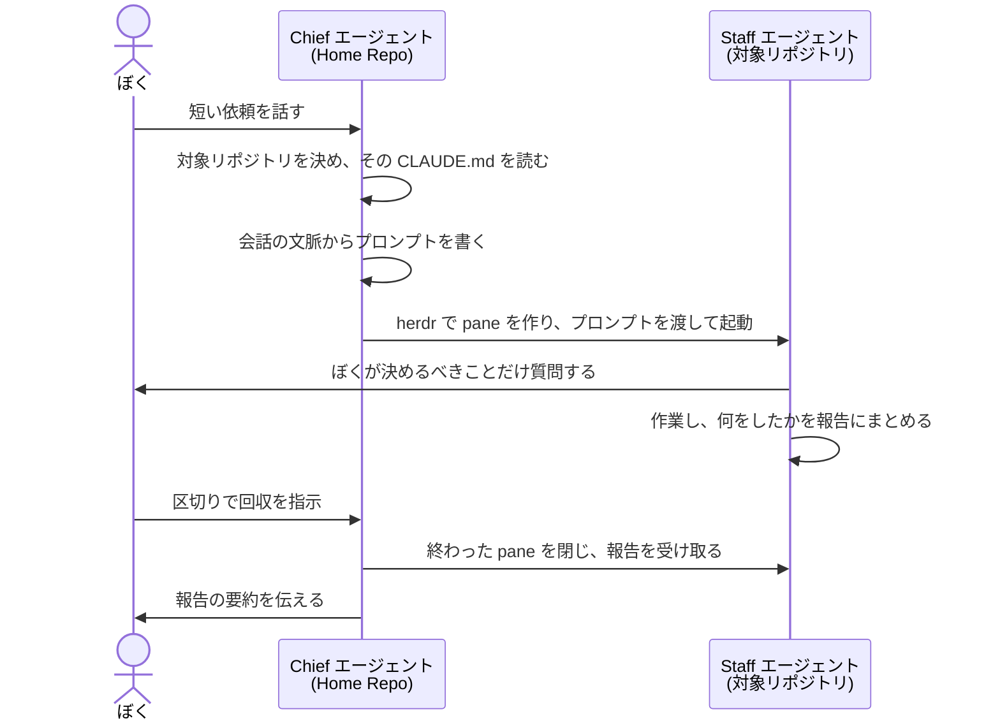

バックエンドのコードを修正したくなったらバックエンドリポジトリにいって作業して、戦略練るときはそのためのリポジトリに移動する。ブログを書きたくなったらblogリポジトリに移動して、エージェントを立ち上げる。そして、立ち上げたエージェントにも、さっき別のエージェントに話したばかりの背景を一から説明し直す。いやぁダルいっす、趙ダルい。

打ち直す手間も面倒だけど、「このエージェントには、あの前提をもう話したっけ」とか覚えておくことがダルい。並行して動かすエージェントが3つとか4つとか増えると、誰に何を渡したかを全部頭の中で覚えておくのがダルい。覚えきれなくなると、渡し忘れた前提をエージェントが適当に補って、適当な作業が返ってくる。

人に仕事をお願いするときも同じですよね。相手がエージェントになっただけ。

そこで、いまはプロンプトを書く役のエージェントを1つ置くようにしました。Chief of Staffエージェントです。
Chiefエージェントは[Home Repo](https://www.aihero.dev/the-home-repo-pattern)と呼ばれる他リポジトリを横断できる1つのリポジトリで動き、ぼくとの会話から各作業のプロンプトを書いて、Staffエージェントに渡します。Staffエージェントは作業が終わると、何をしたかをChiefエージェントに報告します。ぼくから話しかける相手はChiefエージェントだけになりました。


[:contents]

# 構成

## Home Repo で Chief エージェントを動かす

元にしているのは、Matt Pocockさんが紹介しているHome Repoパターンです。

[https://www.aihero.dev/the-home-repo-pattern:embed]

複数のリポジトリで作業していると、エージェントをどこで起動するかが問題になります。
あるリポジトリで起動したエージェントには、そのリポジトリしか見えません。かといってリポジトリごとにSkillや設定を置くと、同じものがあちこちに複製されます。

そこで、Home Repoパターンはエージェントの起動場所を1つに決めてしまいます。共有のスキルやCLAUDE.mdを置いたリポジトリをHome Repoとし、エージェントはいつもそこで起動します。ほかのリポジトリへはCLAUDE.mdに書いた1行の「ポインタ」でたどります。例えばぼくのHome Repoでは、ブログのリポジトリへのポインタはこんな1行です。

```markdown
- blog（はてなブログ kiririmode.hatenablog.jp のエントリ管理）: ~/src/github.com/kiririmode/blog。見つからなければ clone する。最初に CLAUDE.md を読む。
```

ChiefエージェントはこのHome Repoで動きます。

## Chief エージェントがプロンプトを書き、Staff エージェントを起動する

全体の流れはこうなっています。



ぼくがChiefエージェントに話す依頼は短いものです。「この記事をzettelkastenのzettelにして」くらいしか言いません。

Chiefエージェントはまず、どのリポジトリでやる作業かを決めます。ここでHome Repoのポインタを使います。Chiefエージェントは各リポジトリの場所と最初に読むファイルを知っているので、対象リポジトリのCLAUDE.mdを読み、作業の規約を確かめてからプロンプトを書けます。対象リポジトリを人が指定する必要はありません。判断がつかないときはHome Repoで作業させます。

指示プロンプトもAIに書かせていて、目的、背景、制約、完了条件、未確定事項の5つを書かせています。

Staffエージェントの起動にはherdrを使っています。

[https://herdr.dev/:embed]

herdrは結構みんな使ってると思いますが、AIのコーディングエージェント向けのターミナル作業環境です。画面をpaneに分割して、それぞれのpaneでエージェントを動かせます。CLIからpaneを作り、そこでエージェントを起動し、プロンプトを送り込めます。
herdrにはこの操作をエージェントに教える[herdrスキル](https://herdr.dev/ja/tui/docs/agent-skill/)も付いてきます。ぼくはこのスキルを手がかりに、ChiefエージェントがStaffエージェントを起動する仕組みを作っていて、中身はherdrのCLIを呼ぶ小さなシェルスクリプトです。対象リポジトリを作業ディレクトリにしたpaneを作り、Staffエージェントを起動して、プロンプトを渡します。

[https://herdr.dev/ja/tui/docs/agent-skill/:embed]

## Staff エージェントが報告し、Chief エージェントが回収する

Staffエージェントには作業の報告を書かせています。見出しは3つ。

```markdown
## 作ったもの・変えたもの
## 依頼の外でしたこと・依頼のうちしなかったこと
## 残した課題と、未コミットのまま残したもの
```

報告は、ファイルを変えたりコミットしたりしたターンが終わるたびに書き直させます。作業のあとで、ぼくがStaffエージェントのpaneに直接追加の指示を出すことがあるからです。指示を足しても、報告は最新のまま保たれます。

staffが行なったり考えたりした結果の回収は、ぼくが区切りでChiefエージェントに頼みます。Chiefエージェントは終わったStaffエージェントのpaneを閉じ、報告を受け取ります。ぼくへの質問で止まっているpaneや、裏でまだ作業が走っているpaneは閉じずに残します。

# なぜこの構成にしたのか

## 誰に何を渡したかを Chief エージェントが覚えている

「誰に何を渡したか」の記憶というものは、一般に「トランザクティブ・メモリー」と呼ばれます。チームのメンバーが「誰が何を知っているか」を共有している状態を指します。全員が同じことを知っている必要はありません。誰に聞けばよいかを分かっていれば、チームは回ります。
エージェントを並行して動かしていた頃のぼくは、このトランザクティブ・メモリーを一人で頭に抱えていました。エージェントは、記憶なしで起動するからな。
Addy Osmaniも、書き残していない意図はエージェントには存在しないのと同じ、人類は、意図を伝えるコストを走らせるエージェントの数だけ毎回払うことになる、と書いています。

[https://addyosmani.com/blog/intent-debt/:embed]

Home RepoでChiefエージェントを動かすと、ブログの依頼もナレッジベースの依頼も、1つの会話に集まります。誰に何を渡したかを覚えておくのは、Chiefエージェントの役目になりました。ぼくは「あの前提、話したっけ」を気にしなくてよくなります。

全部を1か所に集めることで、Chiefエージェントの文脈がパンパンになっていくのがアレなのですが、まぁ最近Claude Codeでは[`idleCompaction`](https://code.claude.com/docs/en/settings-reference#idlecompaction)もデフォ有効で適当にコンパクションしていくし、なんとかなるんじゃないっスかね？知らんけど。

## 文脈を持つ人がプロンプトを書く

Chiefエージェントが書くプロンプトは、ぼくが自分で書いていた頃より精度がいいです。あと書かなくて良いのでダルくない。理由は2つあります。

1つ目は、会話の文脈がプロンプトに入ることです。ぼくの依頼はめっちゃ短いですが、その前後の会話で、何を気にしているかや、何をしてほしくないかを話してるし、Staffからの報告も届いている。Chiefエージェントはそれを読み取り、背景や制約としてプロンプトに書きます。

2つ目は渡す前の下調べです。Chiefエージェントは対象リポジトリのCLAUDE.mdやスキルを読んでからプロンプトを書きます。たとえば「zettelにして」という短い依頼も、ナレッジベースのどのスキルを使う作業なのかを、渡す前に解釈しておけます。既にノートがあるかも、渡す前に確かめます。Staffエージェントはそれを自分で探し回らずに済みます。

あと、地味に役に立っているのが「未確定事項」の欄です。Chiefエージェントには推測をプロンプトの本文に事実として書かず、未確定事項に分けて書かせています。Staffエージェントは自分で調べて決めればよいことと、ぼくに聞かなければならないことを区別できます。

ぼくは、文脈さえ揃っていれば、プロンプトは人よりAIのほうがうまく書くと思っています。毎回新しいモデルが出るたびに、人間がそのモデル用のプロンプトの書き方を学ぶのダルすぎるだろ。
あと、人は自分にとって当たり前の前提を書き落とすわけね。皆さんは頭がいいからできるかもしれないけど僕は無理。1件目は一生懸命書いたとしても、3件目の依頼は手を抜くよ。怠惰だからな。一方、AIは会話に出た前提を律儀に書き出し、3件目も10件目も同じ形式で書きます。

## 見張らずに回収する

仕事を誰かに任せたとき、任せた側にも負荷がある。僕は人への委譲が苦手なのでこのあたりの負荷が何かを考えたことがあるんだけど、任せた仕事進んでるかなって気にするモニタリングの負荷と、お願いしたことについて議論するために自分も考えておくという負荷と、任せた仕事を受け取るときの負荷です。それぞれ別の手段で下げる必要があります。

モニタリング負荷については、ぼくはStaffエージェントのpaneを見て「おうおうやっとるわ」と思えばいい。自分も考えておく負荷については、Staffエージェントに「ぼくが決めるべきことだけ質問して！」と指示して減らしています。受け取る時の負荷は、staffからの軽くしているのと、chiefエージェントがわかっておればよいわ、で消しています。

staffから回収した報告はChiefエージェントの会話に入ります。Staffエージェントが依頼の外でしたことや、ぼくがpaneで直接指示したことも、報告を通じてChiefエージェントに戻ります。だから、Chiefエージェントの「誰に何を渡し、何が起きたか」は実態とずれません。たぶん。いまのところはうまくいってる。

# 最後に

万能ではありません。Chiefエージェントの会話も長くなれば膨らむので、区切りで立て直しています。
Staffエージェントの報告は自己申告なので、書き漏らしもありえます。書き漏らしに気付いたときは、Staffエージェントを`claude --resume`で開いて聞き直せば済むやろ、くらいに考えてます。
それから、回収までの時差もあります。ぼくがStaffエージェントのpaneで決めたことがほかのStaffエージェントにも関係するとき、Chiefエージェントがそれを知るのは回収のときです。それまでは、ぼくが覚えておくか、自分で伝えるしかありません。
